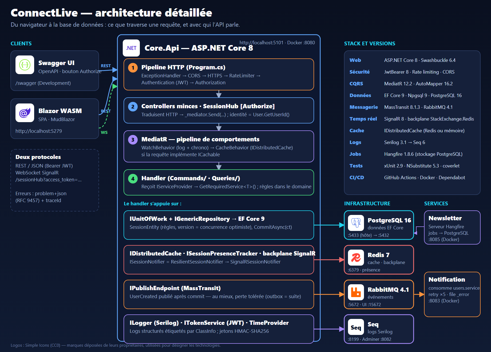
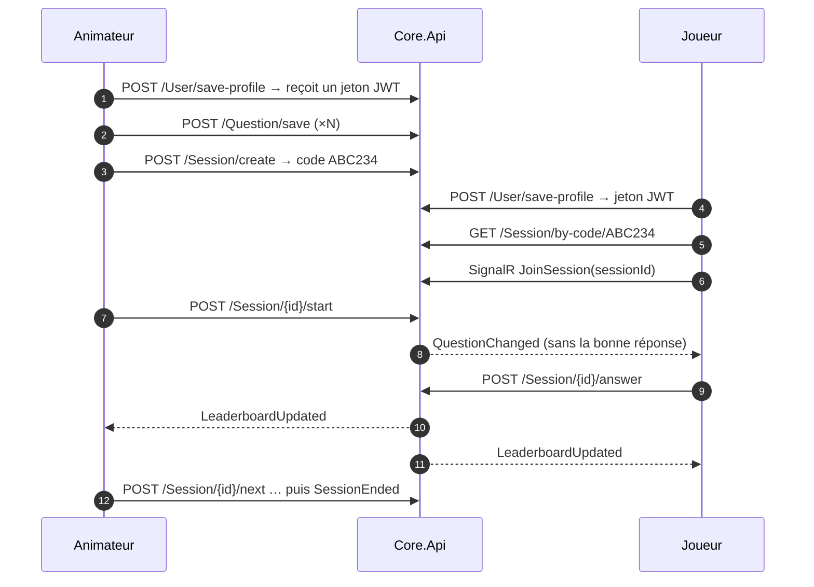
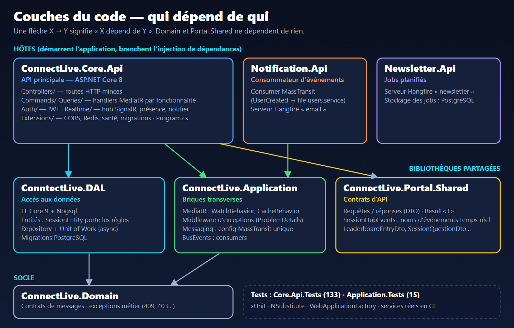
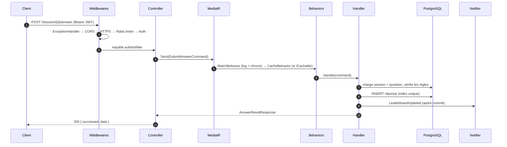
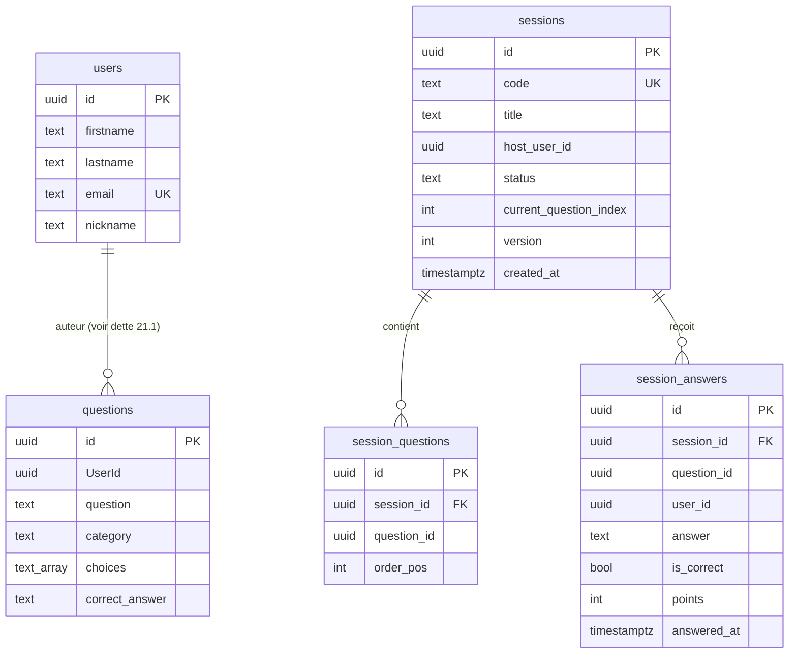
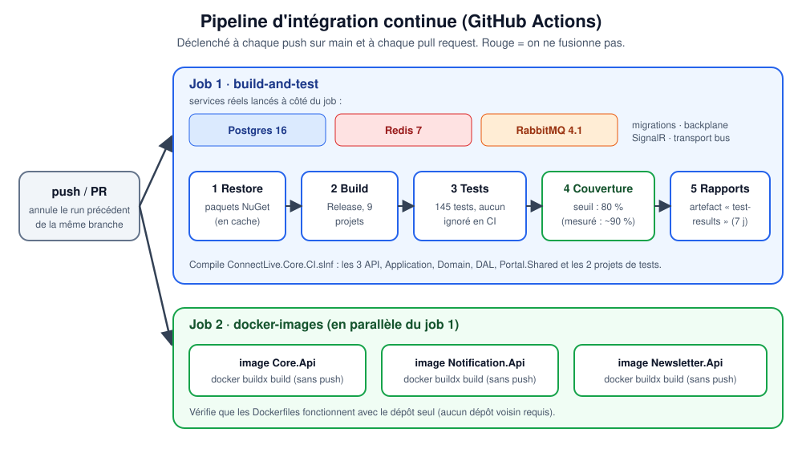

# Guide d'architecture — ConnectLive

> **Pour qui ?** Un ingénieur backend qui découvre le projet et veut le comprendre de bout en bout (architecture,
> technologies, communications, injection de dépendances, bibliothèques, services) avant de coder.
> **Durée de lecture :** ~30 minutes. Chaque section renvoie vers un document de détail quand il existe.



## Sommaire

1. [Le produit en deux minutes](#1-le-produit-en-deux-minutes)
2. [Vue d'ensemble : trois services, quatre briques d'infrastructure](#2-vue-densemble)
3. [Structure du dépôt et règles de dépendance](#3-structure-du-dépôt-et-règles-de-dépendance)
4. [Cycle de vie d'une requête](#4-cycle-de-vie-dune-requête)
5. [CQRS avec MediatR](#5-cqrs-avec-mediatr)
6. [Injection de dépendances (DI)](#6-injection-de-dépendances-di)
7. [Données : PostgreSQL, EF Core, règles métier](#7-données--postgresql-ef-core-règles-métier)
8. [Sécurité](#8-sécurité)
9. [Communications : qui parle à qui, avec quel protocole](#9-communications--qui-parle-à-qui-avec-quel-protocole)
10. [Temps réel : SignalR et backplane Redis](#10-temps-réel--signalr-et-backplane-redis)
11. [Événements : MassTransit et RabbitMQ](#11-événements--masstransit-et-rabbitmq)
12. [Cache](#12-cache)
13. [Observabilité et exploitation](#13-observabilité-et-exploitation)
14. [Configuration](#14-configuration)
15. [Bibliothèques utilisées](#15-bibliothèques-utilisées)
16. [Services, ports et Docker](#16-services-ports-et-docker)
17. [Stratégie de tests](#17-stratégie-de-tests)
18. [CI/CD et qualité](#18-cicd-et-qualité)
19. [Décisions d'architecture et leurs raisons](#19-décisions-darchitecture-et-leurs-raisons)
20. [Guides pratiques](#20-guides-pratiques)
21. [Dette connue et pièges](#21-dette-connue-et-pièges)
22. [Glossaire](#22-glossaire)
23. [Index des documents](#23-index-des-documents)

---

## 1. Le produit en deux minutes

ConnectLive est une plateforme de **quiz en direct** (esprit Kahoot) :

- Un **animateur** crée des questions, ouvre une **session** et obtient un **code** à 6 caractères.
- Des **joueurs** rejoignent avec le code, reçoivent chaque question **en temps réel**, répondent, et voient le
  **classement** se mettre à jour.
- Le serveur **corrige** les réponses : la bonne réponse ne quitte jamais l'API avant la correction.



Machine à états d'une session : `Lobby → Running → Ended` (détails dans [SESSIONS.md](SESSIONS.md)).

## 2. Vue d'ensemble

| Élément | Rôle | Techno principale |
|---|---|---|
| **Core.Api** | API principale : utilisateurs, questions, sessions, réponses, classement, hub SignalR | ASP.NET Core 8 |
| **Notification.Api** | Consomme les événements (ex. « utilisateur créé ») ; prêt pour l'envoi d'emails | MassTransit, Hangfire |
| **Newsletter.Api** | Serveur de jobs planifiés (file « newsletter ») | Hangfire |
| **SPA** | Interface web (dépôt voisin, non versionné ici) | Blazor WebAssembly, MudBlazor |
| **PostgreSQL** | Base de données unique | EF Core + Npgsql |
| **Redis** | Cache distribué, backplane SignalR, présence des joueurs | StackExchange.Redis |
| **RabbitMQ** | Bus d'événements entre services | MassTransit |
| **Seq** | Consultation des logs structurés | Serilog |

> État honnête : `Core.Api` porte presque toute la logique. `Notification.Api` consomme bien l'événement mais ne fait que
> le journaliser ; `Newsletter.Api` et le serveur Hangfire de Notification sont **prêts mais n'exécutent aucun job**
> (plus aucun code n'en met en file).

## 3. Structure du dépôt et règles de dépendance



```
ConnectLive.Core/                      (le dépôt)
├─ ConnectLive.Core/                   Core.Api  — hôte principal (Program.cs)
│   ├─ Controllers/  Commands/  Queries/  Auth/  Realtime/  Extensions/  Health/  Sessions/  Questions/
├─ ConnectLive.Notification.Api/       hôte consommateur d'événements
├─ ConnectLive.Newsletter.Api/         hôte de jobs
├─ ConnectLive.Application/            briques transverses (MediatR behaviors, exceptions, messagerie)
├─ ConntectLive.DAL/                   EF Core, entités, migrations, repository + unit of work
├─ ConnectLive.Portal.Shared/          contrats d'API (DTO, noms d'événements temps réel)
├─ ConnectLive.Domain/                 contrats de messages, exceptions métier
├─ ConnectLive.Application.Tests/ · ConnectLive.Core.Api.Tests/
├─ docs/  .github/  docker-compose*.yml  ConnectLive.Core.CI.slnf
```

**Règles de dépendance** (vérifiées dans les `.csproj`) :

| Projet | Dépend de |
|---|---|
| `Domain`, `Portal.Shared` | rien |
| `Application` | `Domain` |
| `DAL` | `Domain` |
| `Core.Api` | `Application`, `DAL`, `Portal.Shared` |
| `Notification.Api` | `Application`, `Domain` |
| `Newsletter.Api` | rien (Hangfire seul) |

À retenir :
- **Les hôtes sont les « racines de composition »** : ce sont eux (et eux seuls) qui connaissent toutes les implémentations
  et branchent l'injection de dépendances.
- Le **nom `ConntectLive.DAL` contient une faute volontairement conservée** : ne pas la « corriger » (casserait les
  espaces de noms et les migrations).
- **Choix pragmatique** : les handlers MediatR vivent dans `Core.Api` et utilisent directement `DAL`. Ce n'est pas une
  *Clean Architecture* stricte (où l'application ne connaîtrait que des abstractions de persistance) : c'est une
  **architecture en couches** assumée, plus simple, qui convient à la taille du projet.
- Le dépôt est **autonome pour le backend** : `ConnectLive.Core.CI.slnf` compile tout sans dossier voisin.

## 4. Cycle de vie d'une requête



Ordre exact des middlewares (`Program.cs`) : **ExceptionHandler → CORS → HTTPS (hors dev) → RateLimiter →
Authentication → Authorization → endpoints** (contrôleurs, health checks, hub SignalR).

**Gestion des erreurs** : les handlers lèvent des exceptions métier, `ExceptionHandlerMiddleware` les traduit en
*problem details* (RFC 9457, `application/problem+json`, avec `traceId`) :

| Exception | HTTP | Exemple |
|---|---|---|
| `ArgumentException` | 400 | question inconnue, réponse hors choix |
| `UnauthorizedAccessException` | 401 | identité absente du jeton |
| `ForbiddenException` | 403 | non-animateur qui démarre une session |
| `KeyNotFoundException` | 404 | session inconnue |
| `ConflictException` | 409 | transition invalide, email déjà pris, double réponse |
| autre | 500 | message opaque hors Development, journal + alerte |

## 5. CQRS avec MediatR

**Principe** : séparer les *commandes* (qui modifient l'état) des *requêtes* (qui lisent). Un contrôleur ne fait que
`_mediator.Send(...)`.

Conventions du projet :
- Une **classe statique par fonctionnalité** (`SessionCommands`, `QuestionQueries`…) contient, dans des `#region`, chaque
  paire *requête + handler*.
- Les requêtes héritent d'`IntegrationEvent` (donne un `EventId` pour corréler les logs).
- Les identités viennent **toujours** du jeton (`User.GetUserId()`), jamais du corps de la requête : les commandes
  portent `RequesterId` / `HostUserId`.

**Behaviors** (pipeline autour de chaque handler, enregistrés pour toutes les requêtes) :

| Behavior | Rôle |
|---|---|
| `WatchBehavior<,>` | journalise début/fin et durée en ms |
| `CacheBehavior<,>` | si la requête implémente `ICachable<T>` (`Key`, `Expiration` en s) : lit/écrit `IDistributedCache` |

Exemple : `GetUsersQuery` est mis en cache 10 s (clé `AllUsers`), et `SaveUserCommand` **invalide** cette clé.

## 6. Injection de dépendances (DI)

### 6.1 Principe
ASP.NET Core fournit un conteneur de DI natif (`IServiceCollection` → `IServiceProvider`). On **déclare** des services
dans `Program.cs`, le framework les **construit et les injecte**. Trois durées de vie :

| Durée de vie | Signification | Exemples ici |
|---|---|---|
| **Singleton** | une instance pour toute l'application | `TimeProvider`, `ITokenService`, `ISessionPresenceTracker`, `ISessionNotifier`, `IConnectionMultiplexer`, la configuration AutoMapper |
| **Scoped** | une instance **par requête HTTP** | `ApplicationDbContext`, `IUnitOfWork`, `IGenericRepository<>` |
| **Transient** | une nouvelle instance à chaque demande | handlers MediatR, behaviors, `IMapper`, `SessionHub` (un par appel) |

Règle d'or : un singleton ne doit **jamais** dépendre d'un service *scoped* (il le garderait vivant trop longtemps).
C'est pourquoi `ISessionNotifier` (singleton) utilise `IHubContext` (singleton) et non le `DbContext`.

### 6.2 Le catalogue des enregistrements (`Core.Api/Program.cs`)

| Déclaration | Effet |
|---|---|
| `AddControllers`, `AddSwaggerGen` | contrôleurs, documentation OpenAPI (avec schéma Bearer) |
| `AddDbContext<ApplicationDbContext>(UseNpgsql)` | EF Core, **scoped** |
| `AddScoped(typeof(IGenericRepository<>), typeof(GenericRepository<>))` | repository générique (*open generic*) |
| `AddScoped<IUnitOfWork, UnitOfWork>` | un seul `SaveChanges` par requête |
| `AddConnectLiveMessaging(config, consume:false)` | MassTransit si `EventBusConnection` est défini |
| `AddAutoMapper(cfg => cfg.AddProfile<MappingProfile>())` | `IMapper` (configuration explicite, AutoMapper 16) |
| `AddMediatR(RegisterServicesFromAssemblies)` | scanne les handlers |
| `AddSingleton(TimeProvider.System)` | horloge **injectable** (tests déterministes) |
| `AddConnectLiveRealtime(config)` | SignalR, présence, notifier ; backplane Redis si configuré |
| `AddConnectLiveAuthentication(config)` | options JWT validées au démarrage, JwtBearer, `ITokenService` |
| `AddConnectLiveCaching(config)` | `IDistributedCache` (Redis ou mémoire) |
| `AddConnectLiveHealthChecks(config)` | sondes `/health/live` et `/health/ready` |
| `AddTransient(typeof(IPipelineBehavior<,>), typeof(WatchBehavior<,>))` (+ Cache) | behaviors MediatR |
| `AddConnectLiveCors(config, env)` | CORS piloté par la configuration |
| `AddRateLimiter` | politique « registration » : 10 requêtes/min/IP |

Les méthodes `AddConnectLive…` sont des **extensions** qui regroupent un sujet : `Program.cs` reste lisible comme un
sommaire, et chaque extension est testable isolément.

### 6.3 Trois patterns à connaître

**a) Le handler reçoit `IServiceProvider`** (convention de ce dépôt)

```csharp
public class SaveUserCommandHandler : IRequestHandler<SaveUserCommand, SaveUserResponse>
{
    public SaveUserCommandHandler(IServiceProvider serviceProvider)
    {
        _dbContext = serviceProvider.GetRequiredService<ApplicationDbContext>();
        _publisher = serviceProvider.GetService<IPublishEndpoint>(); // facultatif : null sans broker
    }
}
```
*Pourquoi ici* : constructeurs courts, ajout de dépendance sans modifier les signatures, et dépendances **optionnelles**
(`GetService<T>()` renvoie `null`). *Revers* : les dépendances ne se voient plus dans la signature (c'est le *service
locator*, souvent critiqué). Pour du code neuf et simple, l'injection par constructeur reste préférable ; ce dépôt a
choisi l'homogénéité, et les tests couvrent les handlers.

**b) Enregistrement conditionnel selon la configuration**

```csharp
// RealtimeExtensions.AddConnectLiveRealtime
if (string.IsNullOrWhiteSpace(redis))
    services.AddSingleton<ISessionPresenceTracker, SessionPresenceTracker>();      // mémoire
else
    services.AddSingleton<ISessionPresenceTracker, RedisSessionPresenceTracker>(); // partagée
```
Même contrat (`ISessionPresenceTracker`), deux implémentations interchangeables, choisies **une seule fois au démarrage**.
Idem pour le cache (Redis ↔ mémoire) et le bus (RabbitMQ ↔ aucun).

**c) Décorateur** : `ISessionNotifier` est résolu en `ResilientSessionNotifier`, qui **enveloppe** `SignalRSessionNotifier`
et avale (en la journalisant) toute erreur d'envoi : une notification ratée ne transforme pas une action déjà
enregistrée en erreur 500.

```csharp
services.AddSingleton<SignalRSessionNotifier>();
services.AddSingleton<ISessionNotifier>(sp => new ResilientSessionNotifier(
    sp.GetRequiredService<SignalRSessionNotifier>(), sp.GetRequiredService<ILogger<ResilientSessionNotifier>>()));
```

### 6.4 Le *pattern Options*
La configuration JWT est une classe typée validée au démarrage :

```csharp
services.AddOptions<JwtOptions>().Bind(configuration.GetSection("Jwt")).ValidateDataAnnotations().ValidateOnStart();
```
Une clé absente ou trop courte **empêche l'API de démarrer** (échec rapide, plutôt qu'émettre des jetons falsifiables).

### 6.5 DI et tests
Les tests construisent leur propre `ServiceCollection` avec des remplaçants (SQLite en mémoire, `NSubstitute` pour le
notifier) ; les tests d'intégration remplacent des services dans `ConfigureTestServices` (voir `ApiFactory`). C'est le
bénéfice concret de la DI : on change l'infrastructure sans toucher au code métier.

## 7. Données : PostgreSQL, EF Core, règles métier



> Schéma simplifié : les vrais noms de colonnes utilisent des tirets (`host-user-id`, `session-id`, `order`…).

- **Une base, un moteur** : PostgreSQL partout ([POSTGRES-DOCKER.md](POSTGRES-DOCKER.md)). `choices` est un `text[]` natif.
- **Les règles vivent dans l'entité** : `SessionEntity` expose `Start`, `MoveNext`, `End` (setters privés) ; une transition
  interdite lève `ConflictException`. Ces règles se testent sans base ni HTTP.
- **Concurrence optimiste** : `Version` (`[ConcurrencyCheck]`) augmente à chaque transition ; deux « suivant » simultanés
  → le second reçoit 409 au lieu de sauter deux questions.
- **Intégrité par la base** : index uniques `sessions.code`, `users.email`, et
  `(session, question, joueur)` sur `session_answers` (impossible de répondre deux fois, même en cas de course).
- **Repository + Unit of Work** : `IGenericRepository<T>` (`GetByIdAsync`, `Query()` en lecture seule, `AddAsync`,
  `Update`, `Remove`) et `IUnitOfWork.CommitAsync(ct)` = un seul `SaveChangesAsync` (une transaction).
- **Migrations** : `ConntectLive.DAL/Migrations`, appliquées au démarrage en Development, par une étape de déploiement en
  production. Un test échoue si le modèle diverge des migrations.

## 8. Sécurité

Détail : [AUTHENTIFICATION.md](AUTHENTIFICATION.md).

| Mécanisme | Où | Comportement |
|---|---|---|
| **JWT Bearer** (HMAC-SHA256) | `Auth/` | émis **une seule fois** à l'inscription (`signature.secret`), 480 min, claims `sub`, `nickname`, `jti` |
| **Autorisation par rôle métier** | `SessionTransition` | start/next/end réservés à l'animateur (`HostUserId`) → 403 sinon |
| **Identité non falsifiable** | contrôleurs, hub | l'identifiant vient du jeton ; `hostUserId` du corps ignoré ; `JoinSession(sessionId)` sans `userId` |
| **Limitation de débit** | `AddRateLimiter` | inscription : 10/min/IP → 429 |
| **CORS** | `CorsExtensions` | origines de `Security:AllowedOrigins` ; sans config : ouvert en Development, **fermé** sinon |
| **Validation d'entrée** | DTO + `[ApiController]` | attributs `DataAnnotations` → 400 |
| **Secrets** | configuration | `Jwt__SigningKey` hors dépôt ; l'API refuse de démarrer sans |
| **Dépendances** | CI + Dependabot | échec de la CI si un paquet vulnérable apparaît ([SECURITE-DEPENDANCES.md](SECURITE-DEPENDANCES.md)) |
| **Données de jeu** | `SessionQuestionDto` | la bonne réponse n'est jamais envoyée aux joueurs |

## 9. Communications : qui parle à qui, avec quel protocole

| De → Vers | Protocole | Contenu | Détail |
|---|---|---|---|
| Navigateur → Core.Api | **HTTPS REST/JSON** | commandes et requêtes, `Authorization: Bearer` | §4 |
| Navigateur ↔ Core.Api | **WebSocket (SignalR)** | `QuestionChanged`, `LeaderboardUpdated`, `UserJoined/Left`, `SessionEnded` | [SIGNALR-REALTIME.md](SIGNALR-REALTIME.md) |
| Core.Api → PostgreSQL | **SQL** (Npgsql) | lectures/écritures EF Core | §7 |
| Core.Api ↔ Redis | **RESP** | cache (`IDistributedCache`), présence (clés/hash), backplane SignalR (Pub/Sub) | [SIGNALR-BACKPLANE-REDIS.md](SIGNALR-BACKPLANE-REDIS.md) |
| Core.Api → RabbitMQ | **AMQP** | événement `UserCreated` (JSON MassTransit) | [MASSTRANSIT-FLUX.md](MASSTRANSIT-FLUX.md) |
| RabbitMQ → Notification.Api | **AMQP** | consommation sur la file `users.service` | idem |
| Instance API ↔ instance API | **via Redis** | un message émis sur A atteint les clients de B | §10 |
| Core.Api, Notification → Seq | **HTTP** (Serilog sink) | logs structurés | §13 |
| Hangfire (Notification, Newsletter) → PostgreSQL | SQL | stockage des jobs | §2 |

Deux styles de communication, deux usages :
- **Synchrone (REST)** : l'appelant attend la réponse (créer une question, répondre).
- **Asynchrone (événements, temps réel)** : on **publie** un fait (« utilisateur créé », « question suivante ») sans savoir qui
  l'écoutera ; c'est ce qui découple les services.

## 10. Temps réel : SignalR et backplane Redis

- `SessionHub` ne gère que la **présence** (`JoinSession`, `LeaveSession`, déconnexion). Les événements métier sont
  poussés côté serveur via `ISessionNotifier` (les handlers ne dépendent donc pas de SignalR).
- Un **groupe SignalR par session** : `session:{id}`.
- Le jeton JWT passe par `?access_token=` (les WebSockets ne portent pas d'en-tête `Authorization`), **uniquement** sur le
  chemin du hub.
- **Plusieurs instances** : sans backplane, une instance ne connaît que ses clients. Avec `ConnectionStrings:Redis`,
  SignalR utilise un **backplane Redis** et la présence est stockée dans Redis. Vérifié par un test à deux serveurs
  réels. Il faut en production des sessions collantes ou des WebSockets seuls.
- `ResilientSessionNotifier` : un échec d'envoi n'annule pas l'action ; les clients se resynchronisent par `GET`.

## 11. Événements : MassTransit et RabbitMQ

- **Un seul endroit** de configuration : `Application/Messaging/MessagingExtensions.AddConnectLiveMessaging(config, consume)`.
  Sans `EventBusConnection`, MassTransit n'est pas enregistré (l'API tourne sans broker).
- `Core.Api` **publie** `UserCreatedContractQuery` après l'inscription (au mieux : perdu si le broker est en panne).
- `Notification.Api` **consomme** sur la file `users.service` avec retry exponentiel (5 essais) puis file `users.service_error`.
- Le **contrat** (`ConnectLive.Domain/Contracts`) est la frontière entre services : ne jamais renommer/déplacer la classe sans
  créer une nouvelle version (le nom de l'exchange en dérive).

Schéma complet et vocabulaire : [MASSTRANSIT-FLUX.md](MASSTRANSIT-FLUX.md).

## 12. Cache

`IDistributedCache` : **Redis** si `ConnectionStrings:Redis` est défini, sinon mémoire du process (même contrat).
`CacheBehavior` ne met en cache que les requêtes `ICachable` ; les entrées illisibles sont traitées comme absentes.
Les requêtes de session ne sont **volontairement pas cachées** (leur état change à chaque question). Voir [REDIS-CACHE.md](REDIS-CACHE.md).

## 13. Observabilité et exploitation

| Outil | Rôle |
|---|---|
| **Serilog → Seq** | logs structurés, enrichis (`Context` = nom de l'assembly via `ClassInfo`, machine, IP) ; Seq sur `:8199` |
| **`WatchBehavior`** | durée de chaque commande/requête dans les logs, corrélée par `EventId` |
| **`traceId`** | présent dans chaque erreur `problem+json` : retrouver la requête dans les logs |
| **`/health/live`** | le process répond (aucune dépendance) |
| **`/health/ready`** | PostgreSQL (et Redis si configuré) ; 503 sinon ; ne renvoie aucun détail interne |
| **Niveaux de log d'erreur** | 4xx = avertissement ; 5xx = erreur + « alerte admin » (`SendExceptionToAdmin`, aujourd'hui un simple log critique) |

## 14. Configuration

Ordre de priorité (le dernier gagne) : `appsettings.json` → `appsettings.{Environment}.json` → variables d'environnement
→ ligne de commande. Dans les variables d'environnement, `:` devient `__` (`Jwt__SigningKey`).

| Clé | Rôle | Dev | Prod |
|---|---|---|---|
| `ConnectionStrings:ConnectLiveContext` | PostgreSQL | `localhost:5433` (fournie) | **à fournir** (secret) |
| `ConnectionStrings:Redis` | cache + backplane + présence | vide (mémoire) / `redis:6379` en Docker | recommandé |
| `Jwt:SigningKey` | clé de signature (≥ 32 car.) | clé de dev publique | **obligatoire** (secret) |
| `Jwt:Issuer`, `Jwt:Audience`, `Jwt:ExpiryMinutes` | paramètres du jeton | valeurs par défaut | idem |
| `Security:AllowedOrigins` | CORS (séparées par `;`) | origines locales | **à fournir** |
| `EventBusConnection`, `EventBusUserName`, `EventBusPassword` | RabbitMQ | vides = bus désactivé | à fournir |
| `Database:MigrateOnStartup` | migrations au démarrage | `true` | `false` (étape de déploiement) |
| `Serilog:SeqServerUrl` | logs | `http://seq` | à fournir |

## 15. Bibliothèques utilisées

Versions lues dans les `.csproj`. « Où » = projet qui les référence.

| Bibliothèque | Version | À quoi elle sert dans ce projet | Où |
|---|---|---|---|
| **ASP.NET Core** | 8 | framework web, middlewares, DI, SignalR, health checks, rate limiting | Core, Notification, Newsletter |
| **MediatR** | 12.2.0 | CQRS : `Send`, handlers, `IPipelineBehavior` | Core, Application |
| **AutoMapper** | 16.2.0 | `SaveUserRequest → UserEntity → SaveUserResponse` (profil explicite) | Core |
| **Entity Framework Core** + **Npgsql provider** | 9.0.0 | ORM, migrations, `text[]`, concurrence optimiste | DAL, Core |
| **Microsoft.AspNetCore.Authentication.JwtBearer** | 8.0.25 | validation des jetons (aussi pour SignalR) | Core |
| **Microsoft.IdentityModel.JsonWebTokens** (transitif) | — | émission des jetons (`JsonWebTokenHandler`) | Core |
| **Microsoft.AspNetCore.SignalR.StackExchangeRedis** | 8.0.25 | backplane SignalR | Core |
| **Microsoft.Extensions.Caching.StackExchangeRedis** | 9.0.0 | `IDistributedCache` sur Redis | Core |
| **StackExchange.Redis** (transitif) | — | présence (`RedisSessionPresenceTracker`), health check | Core |
| **MassTransit** + **MassTransit.RabbitMQ** | 8.1.3 | bus d'événements, retry, files d'erreurs | Application, Notification |
| **Hangfire** + **Hangfire.PostgreSql** | 1.8.6 / 1.20.4 | serveurs de jobs (files `email`, `newsletter`) | Notification, Newsletter |
| **Serilog** (+ `Sinks.Seq`, `Settings.Configuration`, `Extensions.Logging`) | 3.1.1 / 6.0.0 / 8.0.0 | logs structurés | Core, Notification |
| **Swashbuckle.AspNetCore** | 6.4.0 | OpenAPI + Swagger UI (schéma Bearer) | Core, Notification, Newsletter |
| **MessagePack / System.Text.Json / Newtonsoft.Json / Npgsql 6** | versions épinglées | correctifs de sécurité de dépendances transitives | voir [SECURITE-DEPENDANCES.md](SECURITE-DEPENDANCES.md) |
| **xUnit** | 2.9.2 | framework de tests | tests |
| **NSubstitute** | 5.3.0 | doublures (mocks) | tests |
| **Microsoft.AspNetCore.Mvc.Testing** | 8.0.25 | `WebApplicationFactory` : l'API complète en mémoire | Core.Api.Tests |
| **Microsoft.AspNetCore.SignalR.Client** | 8.0.32 | clients SignalR de test (backplane) | Core.Api.Tests |
| **EF Core Sqlite** | 9.0.0 | base en mémoire pour les tests rapides | Core.Api.Tests |
| **coverlet** | 6.0.2 | mesure de couverture | tests |
| **SPA** : Blazor WebAssembly / MudBlazor | 8.0.0 / 6.11.2 | interface (dépôt voisin) | ConnectLive.SPA |

> ⚠ **MassTransit 9** (proposé par Dependabot) est une version à **licence commerciale** et son API diffère : le projet
> reste volontairement sur la 8.x (gratuite). Ne fusionnez pas cette mise à jour sans décision explicite.

## 16. Services, ports et Docker

| Service | Local (hors Docker) | Docker Compose (hôte) | Remarque |
|---|---|---|---|
| Core.Api | `http://localhost:5101` | `8080` | Swagger sur `/swagger` (Development) |
| Notification.Api | `5223` | `8083` | |
| Newsletter.Api | `5077` | `8085` | |
| SPA | `5279` | — | dépôt voisin |
| PostgreSQL | — | `5433` → conteneur `5432` | volume `data-postgres` |
| Redis | — | `6379` | |
| RabbitMQ | — | `5672` (AMQP), `15672` (UI, `user`/`password`) | |
| Seq | — | `8199` | logs |
| Adminer | — | `8082` | consulter la base |

Commandes courantes : voir [POSTGRES-DOCKER.md](POSTGRES-DOCKER.md) et [DEVELOPPEMENT-VISUAL-STUDIO.md](DEVELOPPEMENT-VISUAL-STUDIO.md).
Les Dockerfiles attendent le dépôt dans un sous-dossier `ConnectLive.Core/` du contexte de build.

## 17. Stratégie de tests

**148 tests** (15 + 133), sans compter ceux qui s'ignorent sans infrastructure.

| Niveau | Exemples | Infrastructure |
|---|---|---|
| **Unitaire** (règles métier) | `SessionEntityTests`, `LeaderboardTests`, `TokenServiceTests` | aucune |
| **Handlers** (SQLite en mémoire + doublures) | `SessionHandlersTests`, `AnswerHandlersTests` | aucune |
| **Intégration HTTP** (`WebApplicationFactory`) | `AuthenticationFlowTests`, `GameFlowTests`, `HealthCheckTests` | aucune |
| **Services réels** (activés par variable d'environnement) | `PostgresMigrationTests`, `RedisPresenceTrackerTests`, `SignalRBackplaneTests`, `RabbitMqTransportTests` | Postgres, Redis, RabbitMQ |

- Variables : `CONNECTLIVE_TEST_POSTGRES`, `CONNECTLIVE_TEST_REDIS`, `CONNECTLIVE_TEST_RABBITMQ` (+ `_USER`/`_PASSWORD`).
  Sans elles, ces tests sont **ignorés** (pas en échec) ; la **CI les active toujours**.
- **Tests de contrat** : `PresenceTrackerContract` exécute les mêmes scénarios sur l'implémentation mémoire et Redis.
- **Méthode** : tests écrits avant le code (rouge → vert) pour les nouvelles fonctionnalités ; couverture de lignes ~90 %
  mesurée en CI (migrations exclues), seuil bloquant à 80 %.

## 18. CI/CD et qualité



- **GitHub Actions** (`.github/workflows/ci.yml`) : restore → **contrôle des paquets vulnérables** → build → tests (avec
  Postgres, Redis, RabbitMQ réels) → seuil de couverture → artefacts ; en parallèle, **construction des 3 images Docker**.
- **Dependabot** : PR hebdomadaires NuGet et GitHub Actions ; **la CI sert de filet** (elle a déjà rejeté une mise à jour
  incompatible de MassTransit).
- **Pas de CD** : la CI s'arrête à la construction des images (rien n'est publié ni déployé). Détail : [CI.md](CI.md).

## 19. Décisions d'architecture et leurs raisons

| # | Décision | Pourquoi | Compromis |
|---|---|---|---|
| 1 | **PostgreSQL partout** (plus de SQLite) | valider les migrations sur le moteur de production ; types natifs | tests rapides encore en SQLite, complétés par des tests Postgres réels |
| 2 | **CQRS léger avec MediatR** | contrôleurs minces, comportements transverses (log, cache) sans les répéter | un peu d'indirection ; handlers dans l'API (pas de Clean Architecture stricte) |
| 3 | **Règles de session dans l'entité** | testables sans base ni HTTP, état toujours cohérent | l'entité est « riche » (couplage au domaine de session) |
| 4 | **Concurrence optimiste** (`Version`) | pas de verrou, 409 clair en cas de course | le client doit réessayer |
| 5 | **JWT émis à l'inscription** (pas de mot de passe) | quiz « invité » sans friction | pas de reconnexion, pas de révocation (limite assumée) |
| 6 | **Identité toujours issue du jeton** | impossible d'usurper l'animateur ou un joueur | — |
| 7 | **Correction côté serveur** | la bonne réponse ne fuit jamais | la latence de réponse inclut l'aller-retour |
| 8 | **Un seul point de config MassTransit** | supprimer 3 copies divergentes et le mélange 7.x/8.x | — |
| 9 | **Publication d'événements « au mieux »** | l'inscription ne dépend pas du broker | événement perdu si RabbitMQ tombe → *outbox* à faire |
| 10 | **Backplane Redis + présence Redis** | passer à plusieurs instances | Redis devient critique pour le temps réel |
| 11 | **Décorateur résilient pour les notifications** | une panne de push n'annule pas une action enregistrée | les clients doivent savoir se resynchroniser |
| 12 | **Dépôt autonome + `.slnf`** | CI possible sans dossiers voisins | la solution complète reste réservée à Visual Studio |
| 13 | **MassTransit 8.x** (pas 9) | licence gratuite | mises à jour de sécurité à surveiller |
| 14 | **Échecs rapides au démarrage** (clé JWT, options) | pas de service qui tourne mal configuré | oblige à fournir les secrets |

## 20. Guides pratiques

### Ajouter une fonctionnalité (checklist)
1. **Contrat** : DTO dans `Portal.Shared` (avec attributs de validation).
2. **Test d'abord** (rouge) : règle métier ou handler.
3. **Entité** si besoin dans `DAL/Entity` (+ propriété dans `IUnitOfWork`/`UnitOfWork`, `DbSet`, **migration**).
4. **Commande/requête + handler** dans la classe statique de la fonctionnalité (`#region`), héritant d'`IntegrationEvent`,
   avec l'identité de l'appelant en paramètre.
5. **Contrôleur mince** : `[Authorize]`, `_mediator.Send`, identité via `User.GetUserId()`.
6. **Notification temps réel** si nécessaire : via `ISessionNotifier`, **après** le commit.
7. **Documentation** : mettre à jour le document concerné et [AUDIT-360.md](AUDIT-360.md) si cela traite un constat.

### Ajouter un événement entre services
Voir [MASSTRANSIT-FLUX.md](MASSTRANSIT-FLUX.md) (« Ajouter un nouvel événement »).

### Ajouter une migration
`dotnet ef migrations add Nom --project ConntectLive.DAL --startup-project ConnectLive.Core/ConnectLive.Core.Api.csproj`
puis commiter les 3 fichiers générés (le test « sans dérive » échoue sinon).

### Lancer le projet en local
```powershell
docker compose -f docker-compose.yml -f docker-compose.override.yml up -d connectlive-db   # + redis rabbitmq si besoin
dotnet run --project ConnectLive.Core/ConnectLive.Core.Api.csproj --launch-profile http    # http://localhost:5101/swagger
```
Dans Swagger : `POST /User/save-profile`, copier `signature.secret`, bouton **Authorize**.

### Référence des routes

| Route | Accès | Rôle |
|---|---|---|
| `POST /User/save-profile` | public (10/min/IP) | inscription, renvoie le jeton |
| `GET /User/get-profile/{id}` · `get-profiles` | jeton | profils (sans secret) |
| `POST /Question/save` · `GET /Question/all` | jeton | créer / lister **ses** questions |
| `POST /Session/create` | jeton | crée la session (l'appelant devient l'animateur) |
| `GET /Session/{id}` · `by-code/{code}` · `{id}/leaderboard` | jeton | état, résolution du code, classement |
| `POST /Session/{id}/start` · `next` · `end` | jeton + animateur | cycle de vie |
| `POST /Session/{id}/answer` | jeton (pas l'animateur) | répondre à la question courante |
| `GET /health/live` · `/health/ready` | public | sondes |
| `/sessionHub` (SignalR) | jeton (`?access_token=`) | présence + événements temps réel |

## 21. Dette connue et pièges

Suivi complet : [AUDIT-360.md](AUDIT-360.md). Les points qu'un nouvel arrivant doit connaître :

1. **Clé étrangère `questions → users` mal mappée.** Dans `QuestionEntity`, `[ForeignKey("user-key")]` ne désigne aucune
   propriété : EF a créé une colonne fantôme `UserEntityId` (toujours nulle) portant la contrainte, tandis que `UserId`
   (l'auteur réel) **n'a aucune contrainte**. Conséquence : la base n'empêche pas une question d'avoir un auteur inexistant.
   Correction prévue : déclarer la relation dans `OnModelCreating`, migration, et adapter les jeux de test.
2. **Pas de reconnexion ni de révocation de jeton** ; l'inscription est ouverte (limitée par IP).
3. **Événement `UserCreated` perdu si RabbitMQ est en panne** (pas d'outbox).
4. **Hangfire** : serveurs présents, **aucun job** n'est mis en file aujourd'hui.
5. **`Nullable` désactivé dans le DAL** ; nombreux avertissements de nullabilité.
6. **Réponses de succès hétérogènes** (`Result<T>` ou objets bruts) ; pas de versionnage d'API ; `LeaderBoardController` est un stub.
7. **Présence fantôme** : si une instance meurt brutalement, ses participants restent listés dans Redis jusqu'à 12 h.
8. **SignalR derrière un répartiteur de charge** : sessions collantes ou WebSockets seuls obligatoires.
9. **`ConnectLive.Core.sln`** référence des dossiers voisins non versionnés : utiliser le `.slnf` pour le backend.
10. Le classement est **recalculé et renvoyé en entier** à chaque réponse : acceptable pour quelques dizaines de joueurs.

## 22. Glossaire

| Terme | Définition |
|---|---|
| **CQRS** | séparer les commandes (écrire) des requêtes (lire) |
| **Handler** | classe qui traite une commande ou une requête |
| **Behavior (MediatR)** | code qui s'exécute avant/après chaque handler (log, cache) |
| **DI** | injection de dépendances : le framework fournit les objets dont une classe a besoin |
| **Racine de composition** | l'endroit unique (`Program.cs`) où l'on branche les implémentations |
| **Repository / Unit of Work** | accès aux entités / regroupement des écritures en une transaction |
| **Concurrence optimiste** | détecter un conflit à l'écriture (colonne `Version`) plutôt que verrouiller |
| **JWT** | jeton signé qui prouve l'identité (`sub` = identifiant utilisateur) |
| **SignalR** | bibliothèque de temps réel (WebSocket avec repli) |
| **Backplane** | canal commun (Redis) qui relie les instances SignalR |
| **Présence** | qui est connecté à quelle session |
| **Broker / Exchange / Queue** | RabbitMQ / guichet de tri / boîte aux lettres |
| **Consumer / Publisher** | celui qui lit / celui qui publie un message |
| **Dead letter (`_error`)** | file qui garde les messages en échec |
| **Outbox** | table où l'on écrit l'événement dans la même transaction que la donnée, publié ensuite de façon fiable |
| **Problem details** | format standard d'erreur HTTP (RFC 9457) |
| **Health check (live/ready)** | sondes : « le process vit » / « il peut servir du trafic » |
| **Fail fast** | refuser de démarrer plutôt que fonctionner mal configuré |

## 23. Index des documents

| Sujet | Document |
|---|---|
| Vue d'ensemble | **ce guide** · [ARCHITECTURE.md](../ARCHITECTURE.md) |
| Audit et état d'avancement | [AUDIT-360.md](AUDIT-360.md) |
| Sécurité et jetons | [AUTHENTIFICATION.md](AUTHENTIFICATION.md) · [SECURITE-DEPENDANCES.md](SECURITE-DEPENDANCES.md) |
| Jeu (questions, réponses, classement) | [QUESTIONS-REPONSES.md](QUESTIONS-REPONSES.md) · [SESSIONS.md](SESSIONS.md) |
| Base de données | [POSTGRES-DOCKER.md](POSTGRES-DOCKER.md) |
| Événements | [MASSTRANSIT-FLUX.md](MASSTRANSIT-FLUX.md) |
| Temps réel | [SIGNALR-REALTIME.md](SIGNALR-REALTIME.md) · [SIGNALR-BACKPLANE-REDIS.md](SIGNALR-BACKPLANE-REDIS.md) · [REDIS-CACHE.md](REDIS-CACHE.md) |
| Intégration continue | [CI.md](CI.md) |
| Environnement de développement | [DEVELOPPEMENT-VISUAL-STUDIO.md](DEVELOPPEMENT-VISUAL-STUDIO.md) |
| Générateurs des schémas | [img/src/README.md](img/src/README.md) |
