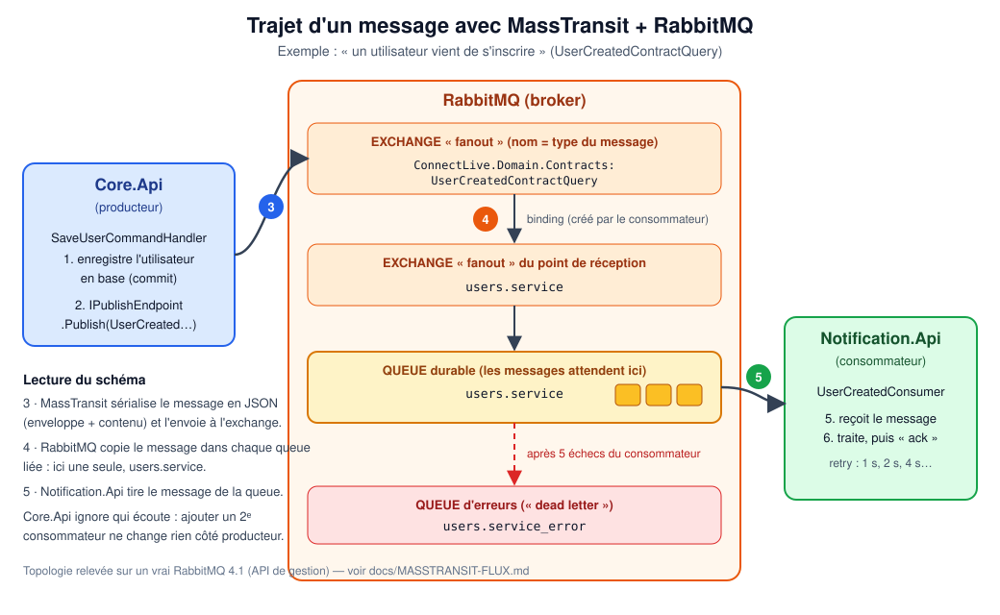

# MassTransit + RabbitMQ : comment les données circulent



## En une phrase

Quand quelque chose d'important se produit (ex. **un utilisateur s'inscrit**), l'API ne prévient pas directement les
autres services : elle **dépose un message** dans RabbitMQ. Chaque service intéressé **vient le lire** quand il est
prêt. Aucun ne connaît l'autre : ils ne connaissent que le **format du message** (le « contrat »).

## Le vocabulaire (à connaître avant de lire le reste)

| Mot | Image mentale | Dans ce projet |
|---|---|---|
| **Message / événement** | une lettre | `UserCreatedContractQuery` (`Email`, `FullName`) |
| **Producteur (publisher)** | celui qui poste la lettre | `Core.Api` (`SaveUserCommandHandler`) |
| **Consommateur (consumer)** | celui qui la lit | `UserCreatedConsumer` dans `Notification.Api` |
| **Broker** | le bureau de poste | RabbitMQ |
| **Exchange** | le guichet de tri : reçoit les lettres et les redistribue | un par type de message, de type *fanout* |
| **Queue (file)** | la boîte aux lettres d'un destinataire | `users.service` |
| **Binding** | la règle « les lettres du guichet X vont dans la boîte Y » | créé automatiquement par MassTransit |
| **Ack** | l'accusé de réception « bien lu, vous pouvez jeter » | envoyé par MassTransit si le consommateur n'a pas levé d'exception |
| **MassTransit** | le facteur qui connaît toutes les règles | bibliothèque .NET qui cache les détails AMQP |

*Fanout* = « copier le message dans **toutes** les files liées ». C'est ce qui permet d'ajouter plus tard un second
consommateur (ex. un service de statistiques) avec **sa propre file**, sans toucher au producteur.

## Le trajet pas à pas

1. **Inscription.** `POST /User/save-profile` → `SaveUserCommandHandler` enregistre l'utilisateur en base (commit).
2. **Publication.** Le handler appelle `IPublishEndpoint.Publish(new UserCreatedContractQuery { … })`.
3. **Envoi.** MassTransit transforme l'objet en JSON (une *enveloppe*, voir ci-dessous) et l'envoie à l'**exchange**
   `ConnectLive.Domain.Contracts:UserCreatedContractQuery`. Le nom de l'exchange est dérivé du **type C# du message**
   (`namespace:NomDeLaClasse`) : renommer ou déplacer la classe change l'exchange !
4. **Routage.** RabbitMQ copie le message vers l'exchange `users.service`, puis dans la **queue** `users.service`
   (liaisons créées quand le consommateur a démarré). Si personne n'écoute encore, le message **attend** dans la file
   (elle est *durable*) : il n'est pas perdu.
5. **Réception.** `Notification.Api` tire le message de `users.service`.
6. **Traitement.** `UserCreatedConsumer.Consume(...)` s'exécute. Sans exception : *ack*, le message est retiré.

## Topologie réelle (relevée sur un RabbitMQ 4.1)

Obtenue avec l'API de gestion (`/api/exchanges`, `/api/queues`, `/api/bindings`) après avoir lancé le consommateur :

| Type | Nom | Rôle |
|---|---|---|
| exchange *fanout* | `ConnectLive.Domain.Contracts:UserCreatedContractQuery` | point d'entrée de ce type de message |
| exchange *fanout* | `users.service` | exchange du point de réception |
| queue (durable) | `users.service` | file lue par `UserCreatedConsumer` |
| bindings | exchange du message → exchange `users.service` → queue `users.service` | acheminement |

## À quoi ressemble un message en transit

Message réellement lu dans la file `users.service` (extrait, `content_type: application/vnd.masstransit+json`) :

```json
{
  "messageId": "488a0000-6451-e86a-f28b-08df2e3abdb2",
  "conversationId": "488a0000-6451-e86a-47ff-08df2e3abdc1",
  "sourceAddress": "rabbitmq://…/<nom-temporaire-du-bus-émetteur>",
  "destinationAddress": "rabbitmq://…/ConnectLive.Domain.Contracts:UserCreatedContractQuery",
  "messageType": [ "urn:message:ConnectLive.Domain.Contracts:UserCreatedContractQuery" ],
  "message": {
    "email": "alice@example.com",
    "fullName": "Alice Martin"
  },
  "sentTime": "2026-10-19T23:43:13Z",
  "headers": {},
  "host": { "machineName": "…", "massTransitVersion": "8.1.3.0", "…": "…" }
}
```

- **`message`** : le contenu métier (notre contrat). Seule cette partie est notre responsabilité.
- **`messageType`** : permet au consommateur de savoir quel type C# reconstruire.
- **`messageId` / `conversationId`** : identifiants de traçage (suivre un message dans les journaux).
- Le message est **persistant** (`delivery_mode: 2`) : il survit à un redémarrage de RabbitMQ.
- ⚠ Le contenu est en **clair** : n'y mettez ni mot de passe ni jeton. L'email figure ici car le service de
  notification en a besoin.

## Que se passe-t-il si le consommateur plante ?

```
Consume() lève une exception ──▶ nouvel essai après 1 s ──▶ 2 s ──▶ 4 s ──▶ 8 s ──▶ … (5 essais, plafond 30 s)
                                                                                   │
                                          toujours en échec ◀──────────────────────┘
                                                   │
                                                   ▼
                            le message est déplacé dans la file  users.service_error
```

- Réglage : `MessagingExtensions.ConsumerRetryCount` (5) et la politique `Exponential(...)`.
- La file `*_error` est la **« dead letter »** : elle garde les messages en échec pour analyse ou rejeu
  (interface RabbitMQ → file → *Move messages*). Surveillez-la : une file `_error` qui grossit = un bug.
- Comportement standard de MassTransit ; la file `_error` n'a pas été exercée en test ici.

## Configuration

| Clé (variable d'environnement identique) | Rôle |
|---|---|
| `EventBusConnection` | URI du broker, ex. `rabbitmq://rabbitmq:5672` (Docker) ou `rabbitmq://localhost:5672` |
| `EventBusUserName` / `EventBusPassword` | compte RabbitMQ (`user`/`password` dans `docker-compose.override.yml`) |

**Sans `EventBusConnection`, MassTransit n'est pas enregistré** : l'API démarre normalement et les publications sont
ignorées. C'est le cas par défaut en développement local sans Docker.

## Où est le code

| Fichier | Rôle |
|---|---|
| `ConnectLive.Domain/Contracts/UserCreatedContractQuery.cs` | le contrat (frontière entre services) |
| `ConnectLive.Application/Messaging/MessagingExtensions.cs` | **configuration unique** : hôte RabbitMQ, file `users.service`, retry |
| `ConnectLive.Application/BusEvents/UserCreatedConsumer.cs` | le consommateur (journalise pour l'instant) |
| `ConnectLive.Core/Commands/UserCommands.cs` | publication après l'inscription (`PublishUserCreatedAsync`) |
| `ConnectLive.Core/Program.cs` | `AddConnectLiveMessaging(config, consume: false)` — Core publie seulement |
| `ConnectLive.Notification.Api/Program.cs` | `AddConnectLiveMessaging(config, consume: true)` — Notification publie et consomme |

Cette configuration **remplace trois copies** (Core, Notification et un dépôt voisin non versionné) et
**supprime le mélange MassTransit 8.1.3 / 7.3.1** : seul MassTransit 8.1.3 est utilisé, avec `UsingRabbitMq` (l'ancien
`AddBus` était obsolète).

## Ajouter un nouvel événement

1. Créer le contrat dans `ConnectLive.Domain/Contracts` (classe simple, propriétés nullables ou avec valeur par défaut).
2. Publier : injecter `IPublishEndpoint` et appeler `Publish(new MonEvenement { … })` **après** le commit en base.
3. Consommer : écrire `class MonConsumer : IConsumer<MonEvenement>`, l'enregistrer avec `x.AddConsumer<…>()` et lui
   donner **sa propre file** dans `MessagingExtensions` (`cfg.ReceiveEndpoint("mon.service", …)`).
4. Évolution d'un contrat : **ajouter** des propriétés est sûr ; **renommer/supprimer/déplacer** casse les messages déjà
   en file. Créer plutôt un nouveau type (`…V2`) et migrer progressivement.

## Vérification

| Niveau | Test |
|---|---|
| Handler publie le bon contenu, pas de doublon, pas de publication si l'email existe | `UserCreatedPublishTests` (harnais MassTransit en mémoire) |
| L'inscription réussit même si le broker est en panne | `Save_StillSucceeds_WhenTheBrokerIsDown` |
| Trajet **réel** publication → exchange → queue → consommateur | `RabbitMqTransportTests` (RabbitMQ réel, `CONNECTLIVE_TEST_RABBITMQ`) |

Lancer le test réel en local :

```powershell
docker run -d --name rmq-test -p 127.0.0.1::5672 rabbitmq:4.1       # port hôte aléatoire
docker port rmq-test 5672                                          # ex. 127.0.0.1:58633
$env:CONNECTLIVE_TEST_RABBITMQ = "rabbitmq://127.0.0.1:58633"
dotnet test ConnectLive.Core.Api.Tests --filter RabbitMqTransportTests
```

## Limites connues (et la suite logique)

- **Publication « au mieux »** : l'utilisateur est d'abord enregistré, puis l'événement publié. Si RabbitMQ est
  indisponible à cet instant, l'inscription réussit mais **l'événement est perdu** (une erreur est journalisée).
  La parade standard est l'**outbox transactionnelle** : écrire l'événement dans la même transaction que
  l'utilisateur, puis le publier de façon fiable en arrière-plan (MassTransit EF Core Outbox). Non faite ici : elle
  ajoute des tables et demande de valider la compatibilité des versions de paquets.
- **Consommation « au moins une fois »** : un même message peut être livré deux fois (retry, redémarrage).
  Les consommateurs doivent être **idempotents** (le consommateur actuel ne fait que journaliser).
- Le consommateur ne fait que journaliser : envoyer le vrai email de bienvenue reste à implémenter.
- Un seul événement existe aujourd'hui (`UserCreated`).
