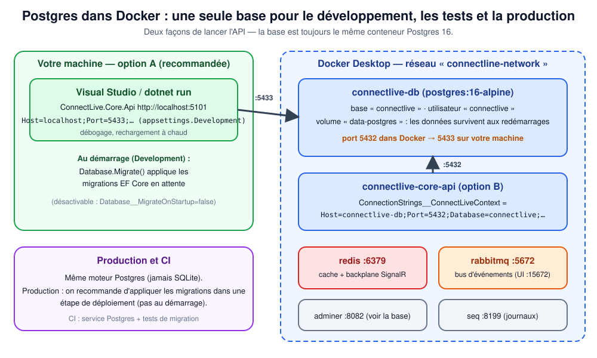

# Postgres dans Docker (base unique)



## Pourquoi Postgres partout (et plus SQLite)

Jusqu'ici l'API tournait sur **SQLite en développement** alors que le `docker-compose` lançait **Postgres** et que
les paquets Npgsql/Hangfire.PostgreSql étaient référencés. Conséquence : les migrations et les requêtes n'étaient
**jamais validées sur le moteur de production**. Exemples de différences qui se paient cher en production :

| Sujet | SQLite | Postgres |
|---|---|---|
| Liste de textes (`QuestionEntity.Choices`) | sérialisée en JSON | type natif `text[]` |
| Dates | texte, fuseau ignoré | `timestamp with time zone` (UTC obligatoire) |
| Contraintes d'unicité, clés étrangères | souples | strictes (nos index uniques deviennent de vraies sécurités) |
| Concurrence (`version` de session) | un seul écrivain à la fois | vraies écritures concurrentes |
| Types, majuscules/minuscules, collations | tolérant | strict |

Choisir **un seul moteur** supprime toute la catégorie « ça marchait en dev ». Les migrations ont été **régénérées pour
Postgres** (migration unique `InitialSchema`) : les anciennes étaient produites pour SQLite et inutilisables ailleurs.

> Les tests unitaires et d'intégration rapides utilisent encore **SQLite en mémoire** (aucun serveur à lancer, ~secondes).
> Ils sont complétés par des tests **Postgres réels** (`PostgresMigrationTests`) qui valident le schéma ; la CI les
> exécute toujours ([CI.md](CI.md)).

## Démarrer la base

### Option A — recommandée : API sur votre machine, base dans Docker

```powershell
# 1. Base (et Redis, RabbitMQ si besoin) dans Docker
docker compose -f docker-compose.yml -f docker-compose.override.yml up -d connectlive-db

# 2. API (Visual Studio ou dotnet run) : applique les migrations toute seule en Development
dotnet run --project ConnectLive.Core\ConnectLive.Core.Api.csproj --launch-profile http
```

L'API se connecte à `localhost:5433` (`appsettings.Development.json`) : le port 5432 du conteneur est publié sur
**5433** pour ne pas entrer en conflit avec un Postgres installé sur la machine.

### Option B — tout dans Docker

```powershell
docker compose -f docker-compose.yml -f docker-compose.override.yml up --build
```

Le conteneur `connectlive-core-api` reçoit `ConnectionStrings__ConnectLiveContext=Host=connectlive-db;Port=5432;…`
(réseau Docker interne) et attend que Postgres soit **healthy** (`pg_isready`) avant de démarrer.

## Chaînes de connexion

| Où | Valeur | Remarque |
|---|---|---|
| `appsettings.json` | `Host=localhost;Port=5433;Database=connectlive;Username=connectlive` | **sans mot de passe** : il doit venir de l'environnement en production |
| `appsettings.Development.json` | idem + `Password=Password1` | mot de passe de développement, identique à `docker-compose.override.yml` |
| Docker (override) | `Host=connectlive-db;Port=5432;…;Password=Password1` | via variable d'environnement |
| Production | `ConnectionStrings__ConnectLiveContext` (variable ou coffre de secrets) | jamais dans le dépôt |

## Migrations

L'entité vit dans `ConntectLive.DAL`, le démarrage dans `ConnectLive.Core.Api` :

```powershell
# créer une migration après avoir modifié une entité
dotnet ef migrations add NomDeLaMigration --project ConntectLive.DAL --startup-project ConnectLive.Core\ConnectLive.Core.Api.csproj

# l'appliquer (le passage par la variable évite de viser la mauvaise base)
$env:ConnectionStrings__ConnectLiveContext = "Host=localhost;Port=5433;Database=connectlive;Username=connectlive;Password=Password1"
dotnet ef database update --project ConntectLive.DAL --startup-project ConnectLive.Core\ConnectLive.Core.Api.csproj

# produire le SQL à faire valider/appliquer par un DBA ou un pipeline de déploiement
dotnet ef migrations script --idempotent --project ConntectLive.DAL --startup-project ConnectLive.Core\ConnectLive.Core.Api.csproj -o migrate.sql
```

| Environnement | Qui applique les migrations | Réglage |
|---|---|---|
| Development | l'API, au démarrage (`DatabaseExtensions.MigrateDatabaseAsync`) | `Database:MigrateOnStartup` vaut `true` par défaut |
| Tests (SQLite) | `EnsureCreated` (schéma créé depuis le modèle) | `Database__MigrateOnStartup=false` imposé par `ApiFactory` |
| Production | **une étape de déploiement** (script SQL ou `dotnet ef database update`) | `Database:MigrateOnStartup` vaut `false` par défaut ; avec plusieurs instances, éviter que chacune migre |

Le test `Migrations_ApplyOnAnEmptyDatabase_WithoutModelDrift` échoue si quelqu'un modifie une entité **sans** créer
la migration correspondante (EF Core 9 signale `PendingModelChangesWarning`).

## Ce qui a été vérifié sur un vrai Postgres 16

- Les migrations s'appliquent sur une base vierge ; 6 tables créées (`users`, `questions`, `sessions`,
  `session_questions`, `session_answers`, `__EFMigrationsHistory`).
- `Choices` est stocké en `text[]` ; les dates en `timestamp with time zone`.
- L'index unique `(session-id, question-id, user-id)` refuse une seconde réponse ; l'email est unique.
- La concurrence optimiste (`version`) lève bien `DbUpdateConcurrencyException`.

## Dépannage

| Symptôme | Cause probable | Remède |
|---|---|---|
| `container name "/connectlive-db" is already in use` | un conteneur du même nom existe déjà (autre projet Compose) | le **réutiliser** (`docker ps`), ou le supprimer ; les `container_name` sont fixes |
| `ports are not available … forbidden by its access permissions` (Windows) | plage de ports réservée par Hyper-V/WSL | choisir un autre port hôte (`netsh int ipv4 show excludedportrange protocol=tcp`) |
| `password authentication failed` | mot de passe différent de celui du volume existant | le mot de passe est figé à la **première** création du volume : `docker compose down -v` (efface les données) |
| `connection refused` sur 5433 | conteneur arrêté ou pas encore healthy | `docker compose ps`, attendre le statut `healthy` |
| Repartir de zéro | — | `docker compose down -v` puis relancer l'API (elle recrée le schéma) |
| Voir les données | — | Adminer : http://localhost:8082 (système PostgreSQL, serveur `connectlive-db`) |

## Fichiers

| Fichier | Rôle |
|---|---|
| `ConnectLive.Core/Program.cs` | `UseNpgsql(...)` + migration au démarrage en Development |
| `ConnectLive.Core/Extensions/DatabaseExtensions.cs` | `MigrateDatabaseAsync` |
| `ConntectLive.DAL/Migrations/*InitialSchema*` | schéma Postgres |
| `docker-compose.override.yml` | identifiants, healthcheck, variable de connexion de l'API |
| `ConnectLive.Core.Api.Tests/Integration/PostgresMigrationTests.cs` | tests sur Postgres réel (base temporaire créée puis supprimée) |
