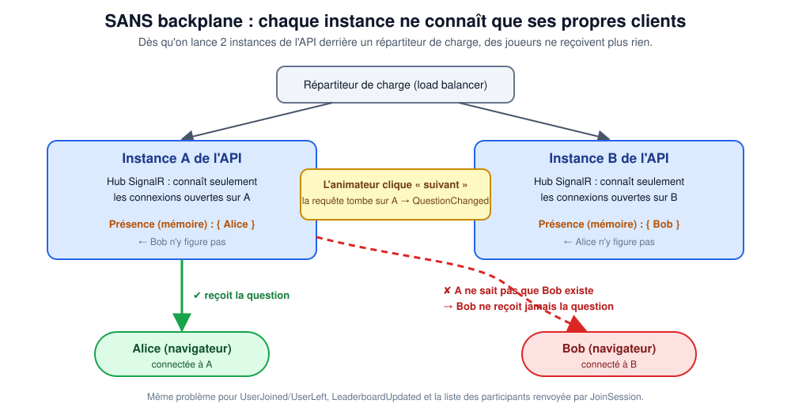
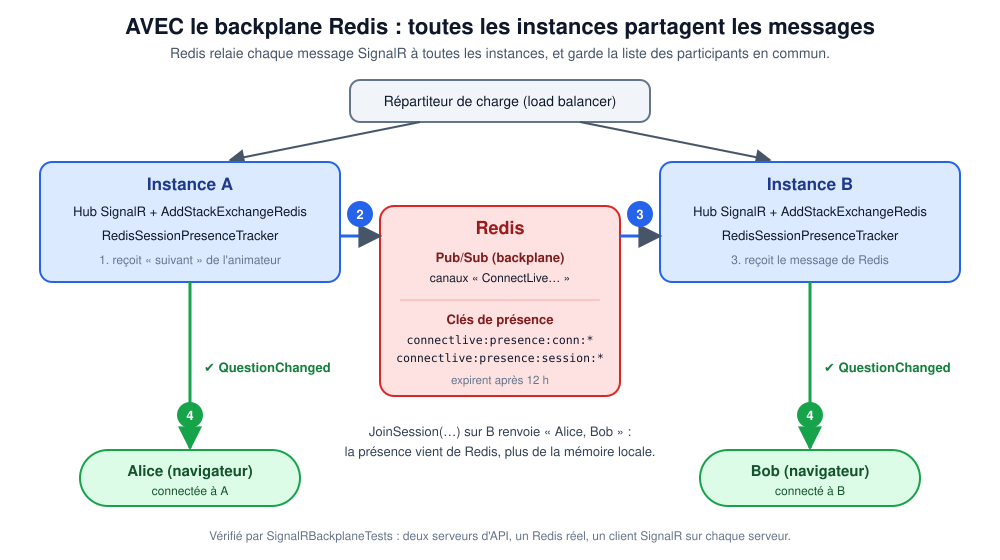
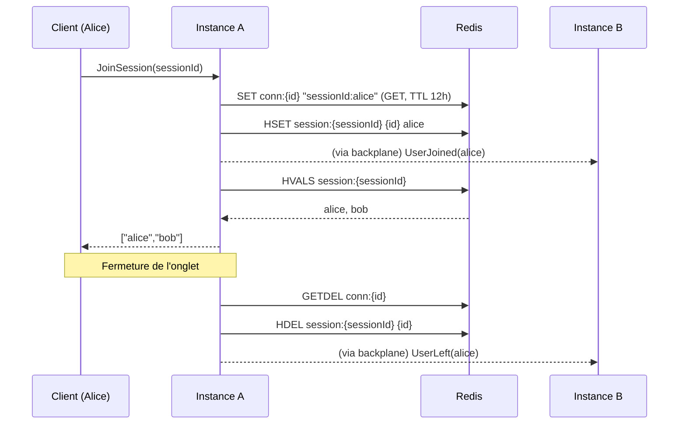

# Backplane Redis pour SignalR

## Le problème : plusieurs instances, des joueurs qui ne reçoivent rien

Un quiz live avec beaucoup de joueurs ne tient pas sur un seul serveur : on lance **plusieurs instances** de l'API
derrière un répartiteur de charge. Or SignalR garde la liste de ses connexions **en mémoire, par instance**.



Alice est connectée à l'instance A, Bob à l'instance B. L'animateur clique « suivant » : sa requête tombe sur A. A envoie
la question à **ses** clients (Alice) mais ignore l'existence de Bob. **Bob ne reçoit jamais la question.** Même chose
pour `UserJoined`/`UserLeft`, pour le classement, et pour la liste de participants renvoyée par `JoinSession`.

## La solution : un « backplane » (fond de panier) Redis



Le backplane est un **canal commun** par lequel passent tous les messages SignalR :

1. L'instance qui doit envoyer un message (ici A) le **publie dans Redis** (Pub/Sub) au lieu de ne l'envoyer qu'à ses clients.
2. **Toutes** les instances sont abonnées à Redis : chacune reçoit le message.
3. Chaque instance le remet **à ses propres clients** connectés au groupe concerné.

Résultat : peu importe sur quelle instance arrive l'ordre, tous les joueurs de la session reçoivent le message.

## Deux choses distinctes sont partagées

| Quoi | Mécanisme | Sans Redis |
|---|---|---|
| **Les messages** (`QuestionChanged`, `LeaderboardUpdated`, `UserJoined`…) | backplane SignalR (`AddStackExchangeRedis`) : Redis **Pub/Sub** | chaque instance isole ses clients |
| **La présence** (qui est connecté à quelle session) | `RedisSessionPresenceTracker` : **clés Redis** | liste locale à l'instance |

Le backplane seul ne suffit pas : il transporte les messages mais **ne sait pas lister les participants**. C'est pourquoi
la présence a été sortie de la mémoire du process (`ISessionPresenceTracker`, deux implémentations interchangeables).

## Activation

Un seul réglage, déjà utilisé pour le cache distribué :

```
ConnectionStrings__Redis=redis:6379          # Docker (docker-compose.override.yml le fait déjà)
ConnectionStrings:Redis = "localhost:6379"   # appsettings / user-secrets
```

| `ConnectionStrings:Redis` | Cache | Messages SignalR | Présence |
|---|---|---|---|
| vide (défaut hors Docker) | mémoire du process | mémoire du process | mémoire du process |
| renseignée | Redis | **backplane Redis** | **Redis** |

Câblage : `RealtimeExtensions.AddConnectLiveRealtime` (appelé par `Program.cs`). Les canaux sont préfixés par
`ConnectLive:` pour partager un Redis avec d'autres applications sans collision.

> Avec Redis configuré, la connexion à Redis est **paresseuse** : pour la présence au premier `JoinSession`, pour le
> backplane à la première utilisation de SignalR. Si Redis est arrêté, le temps réel est en panne :
> surveillez-le comme le reste de l'infrastructure.

## Comment la présence est stockée dans Redis

Deux structures par participant, toutes avec une durée de vie de 12 h :

| Clé | Type | Contenu | Sert à |
|---|---|---|---|
| `connectlive:presence:conn:{connectionId}` | chaîne | `sessionId:userId` | savoir **où est** une connexion (au départ/déconnexion) |
| `connectlive:presence:session:{sessionId}` | hash | `connectionId → userId` | **lister** les participants d'une session |



Choix techniques :
- `SET … GET` et `GETDEL` sont **atomiques** : si deux instances traitent le même départ, une seule « gagne ».
- **Plusieurs onglets** : un utilisateur apparaît une fois (valeurs distinctes), et ne disparaît que quand son
  **dernier** onglet part (une entrée par connexion).
- **Expiration** : si une instance meurt sans passer par `OnDisconnectedAsync`, ses connexions fantômes
  disparaissent d'elles-mêmes après 12 h (voir « Limites »).

## Lancer deux instances en local pour voir le backplane

```powershell
docker compose -f docker-compose.yml -f docker-compose.override.yml up -d connectlive-db redis
$env:ConnectionStrings__Redis = "localhost:6379"

# terminal 1
dotnet run --project ConnectLive.Core\ConnectLive.Core.Api.csproj --urls http://localhost:5101
# terminal 2
dotnet run --project ConnectLive.Core\ConnectLive.Core.Api.csproj --urls http://localhost:5102
```

Connectez un client SignalR à `:5101` et un autre à `:5102`, rejoignez la même session, puis démarrez-la via
`:5101` : les deux clients reçoivent `QuestionChanged`.

## Ce qui a été vérifié (Redis 7 réel)

`SignalRBackplaneTests` démarre **deux serveurs d'API** complets reliés au même Redis, avec un client SignalR par serveur :

- `JoinSession` sur l'instance B renvoie bien Alice (connectée à A) **et** Bob → présence partagée ;
- l'animateur démarre la session sur A → le client de **B** reçoit `QuestionChanged` ;
- Bob répond via B → le client d'Alice (sur **A**) reçoit `LeaderboardUpdated`.

Canaux effectivement créés dans Redis pendant ce test (relevés avec `PUBSUB CHANNELS`) :

| Canal (préfixe `ConnectLive:` + nom du hub) | Rôle |
|---|---|
| `…SessionHub:all` | messages à tous les clients |
| `…SessionHub:group:session:{id}` | messages d'un groupe (ex. une session) — *attendu d'après SignalR, non présent dans l'instantané relevé* |
| `…SessionHub:user:{userId}` | messages à un utilisateur |
| `…SessionHub:connection:{id}` | messages à une connexion |
| `…SessionHub:internal:groups` | ajout/retrait d'une connexion à un groupe entre instances |
| `…SessionHub:internal:ack:{serveur}` / `…:return:{serveur}` | accusés de réception entre instances |

`PresenceTrackerContract` exécute les **mêmes scénarios** sur l'implémentation mémoire et l'implémentation Redis :
elles sont interchangeables. `RedisPresenceTrackerTests.TwoInstances_ShareTheSamePresence` vérifie le partage.

## Pour que ça marche en production

- **Sessions collantes (sticky sessions) ou WebSockets seuls.** Le backplane ne supprime pas cette exigence :
  la négociation SignalR (`/negotiate`) puis la connexion doivent atteindre la **même** instance. Configurez le
  répartiteur en affinité de session, ou imposez les WebSockets et `skipNegotiation: true` côté client.
- **Redis disponible** : c'est désormais un composant critique du temps réel (le cache, lui, peut se reconstruire).
- **Connexion unique et stable** : `ConnectionStrings__Redis` accepte le format StackExchange.Redis
  (`hôte:port,password=…,ssl=true` pour un Redis managé).

## Limites connues

- **Fantômes de présence** : si une instance est tuée brutalement, les participants qu'elle portait restent listés
  jusqu'à l'expiration (12 h). Atténuation possible : battement de cœur (heartbeat) par instance ou TTL plus court
  rafraîchi périodiquement. Non fait.
- **Diffusion bavarde** : `LeaderboardUpdated` envoie le classement **complet** à chaque réponse. Pour quelques dizaines
  de joueurs c'est correct ; au-delà, regrouper les envois (ex. toutes les 500 ms).
- **Pas de garantie de livraison** : Redis Pub/Sub est « tire et oublie ». Un client déconnecté au mauvais moment rate
  le message ; il se resynchronise avec `GET /Session/{id}` et `GET /Session/{id}/leaderboard`.
- Le backplane n'est pas testé en charge ; seul le comportement fonctionnel est vérifié.

## Fichiers

| Fichier | Rôle |
|---|---|
| `ConnectLive.Core/Extensions/RealtimeExtensions.cs` | active backplane + présence Redis selon la configuration |
| `ConnectLive.Core/Realtime/ISessionPresenceTracker.cs` | contrat de présence |
| `ConnectLive.Core/Realtime/SessionPresenceTracker.cs` | implémentation mémoire |
| `ConnectLive.Core/Realtime/RedisSessionPresenceTracker.cs` | implémentation Redis |
| `ConnectLive.Core.Api.Tests/Realtime/*` | contrat + tests mémoire/Redis |
| `ConnectLive.Core.Api.Tests/Integration/SignalRBackplaneTests.cs` | deux instances + Redis réel |
